# Seen

## Diabetes Management Frontend

Seen is a React web frontend for a university graduation project focused on
helping people manage diabetes-related information and day-to-day activities.
The interface brings together glucose logging, health summaries, reminders,
analysis, notifications, and community features in one responsive application.

> **Repository scope:** This repository contains the React frontend only. The
> backend API and the Android application were developed by other members of
> the graduation-project team and are not included here. Backend architecture,
> persistence, API implementation, and Android behavior are therefore outside
> the scope of this README.

## Screenshots and Application Preview

The repository includes frontend screenshots under [`screenshots/`](./screenshots).
They are grouped below by the part of the interface they represent.

### Landing and Authentication

| Landing page | Login | Registration |
|---|---|---|
| 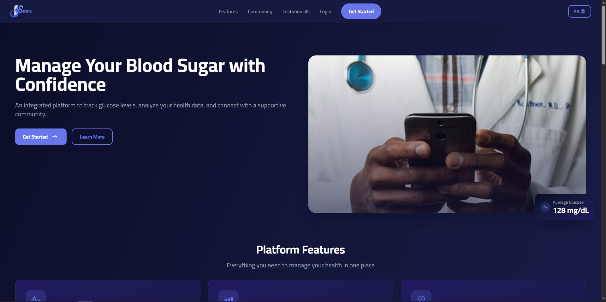 | 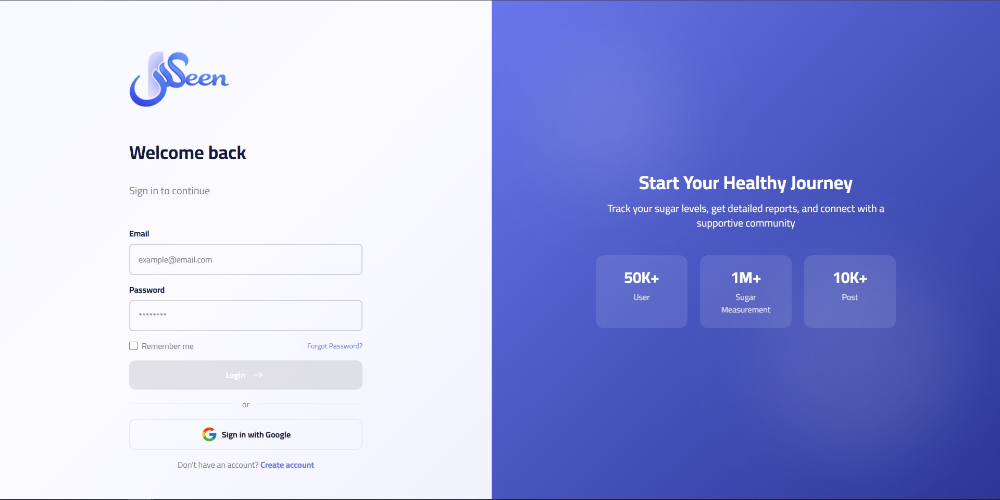 | 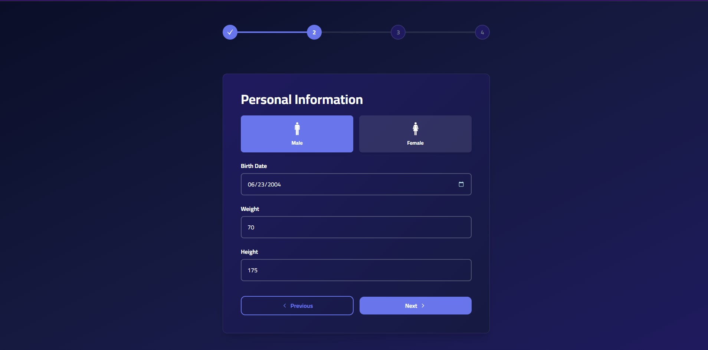 |

### Dashboard and Health Analysis

| Home dashboard | Glucose analysis | Additional analysis view |
|---|---|---|
| 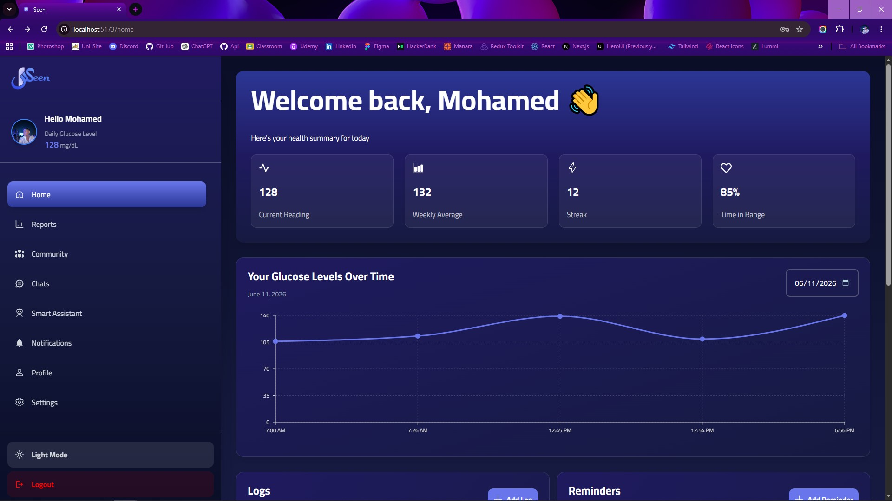 | 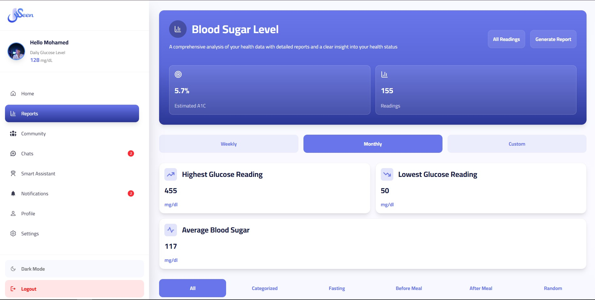 | 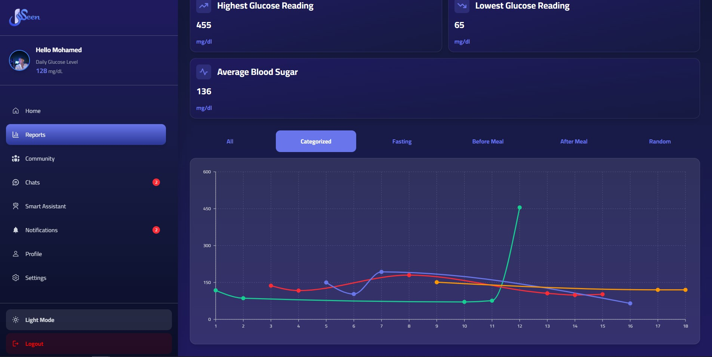 |

### Community

| Community feed | Post details | Likes |
|---|---|---|
| 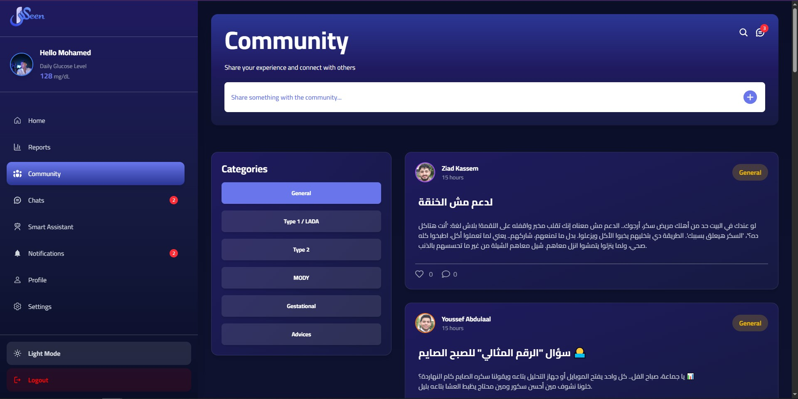 | 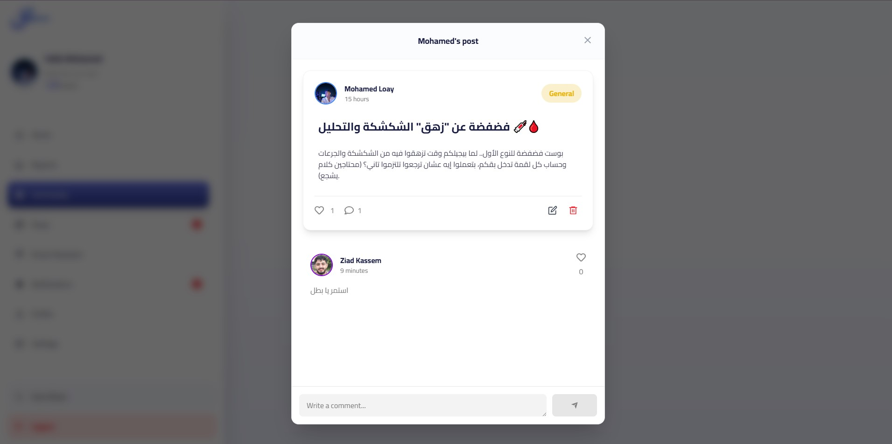 | 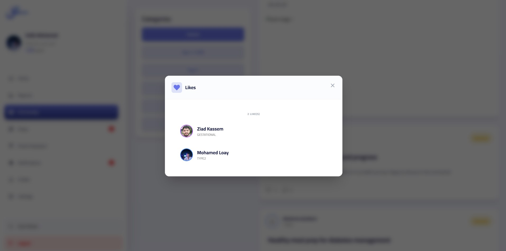 |

### Conversations, Notifications, and Profile

| Chats | Notifications | Profile |
|---|---|---|
| 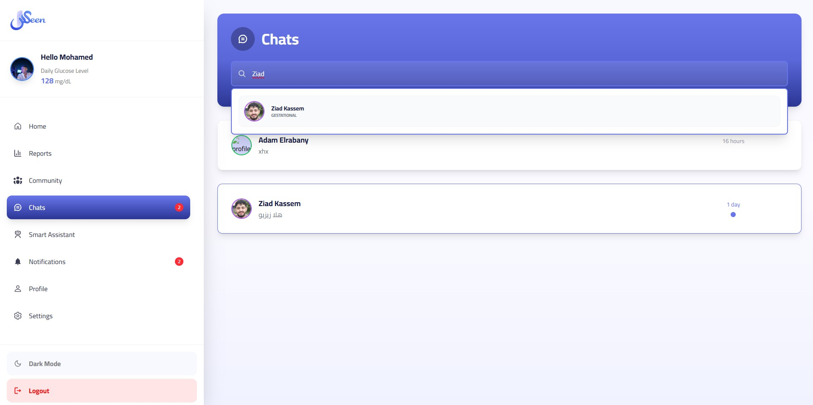 | 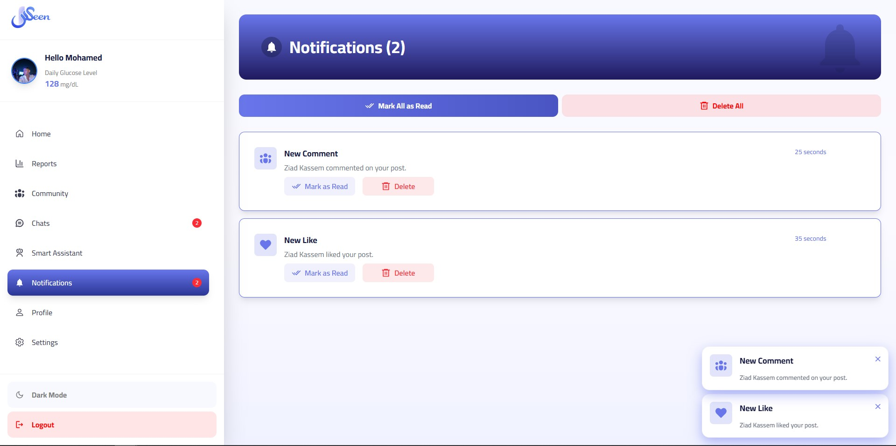 | 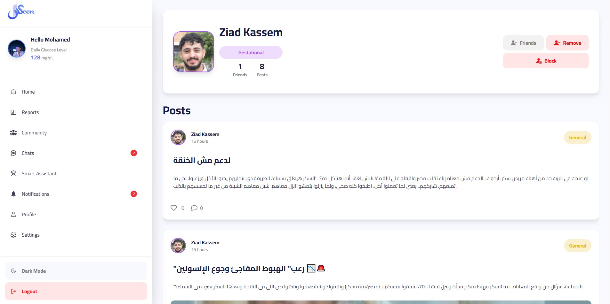 |

## Key Features

The following features are represented by the frontend routes, pages,
components, services, and hooks in this repository:

### Authentication and account management

- Landing page with login and registration entry points.
- Login, registration, and email-existence checks.
- Password recovery using send-OTP, verify-OTP, and reset-password screens.
- Session restoration through the authenticated `me` request.
- Profile display and profile editing, including profile-picture upload
  handling.
- Account settings, password verification/update, logout, and account deletion
  actions.
- Public and protected route boundaries.

### Diabetes tracking and analysis

- Dashboard/home experience for authenticated users.
- Glucose log creation, editing, deletion, detail display, and date-based
  retrieval.
- Glucose reading history and analysis views.
- Date-range analysis requests and client-side glucose-report PDF downloads.
- Reminder creation and reminder status management.
- Medication service functions for retrieving and adding medications.

The frontend provides the screens and API calls for these workflows; the
backend remains responsible for processing and storing the submitted data.

### Community and social interaction

- Categorized community feed with optional category routing.
- Paginated post retrieval, post creation, editing, and deletion.
- Post details, comments, comment editing/deletion, and likes.
- Search and likes views.
- User profiles and user posts.
- Friend requests, accepting/cancelling requests, removing friends, and
  blocking/unblocking users.

### Messaging and assistance

- Conversations list and user-to-user chat pages.
- Paginated message loading, sending, editing, deletion, and read-status
  actions.
- Assistant page with chatbot requests and conversation-history support.
- Laravel Echo/Reverb and Pusher client setup for authenticated real-time
  connection handling.

### Notifications and feedback

- Notifications page with pagination.
- Mark-one/read-all, delete-one/delete-all, and notification state actions.
- Toast notifications through `react-hot-toast`.
- Loading and error pages used by routing and asynchronous UI states.

## Technology Stack

The frontend uses the following technologies, verified from the project
manifest and source code:

- **React 19** and **React DOM** — component-based user interface.
- **Vite** with the React SWC plugin — development server and production
  bundling.
- **React Router DOM** — browser routing, nested layouts, route actions,
  lazy-loaded pages, and protected/public route boundaries.
- **Redux Toolkit** and **React Redux** — client-side user session, theme, and
  notification state.
- **TanStack Query** — query and mutation hooks for server-state operations,
  including community, chat, assistant, and notification workflows.
- **Axios** — centralized HTTP client and request interceptor for the
  configured API base URL.
- **Tailwind CSS** with the Vite plugin — utility-based styling, reusable
  layout utilities, component styling, and dark-mode variants.
- **i18next** and **react-i18next** — Arabic/English translations and
  persisted language selection.
- **Laravel Echo** and **Pusher JS** — Reverb-compatible real-time connection
  setup for authenticated users.
- **Recharts** — charting used by the analysis/health-report interface.
- **Framer Motion** — UI animation and transition support.
- **React Hot Toast** — user feedback notifications.
- **date-fns** — date handling.
- **React Markdown**, `remark-breaks`, and `remark-gfm` — rendered markdown
  content in supported assistant/chat interfaces.
- **React Icons** — interface icons.

## Frontend Architecture

The application is organized by feature and responsibility:

```text
.
├── public/                 # Public logo and icon assets
├── screenshots/            # Frontend preview images
├── src/
│   ├── api/                # Axios client configuration
│   ├── assets/             # Images, SVGs, empty states, and illustrations
│   ├── components/         # Reusable UI, layout, chat, community, and modal components
│   ├── hooks/              # Query, mutation, chat, assistant, and notification hooks
│   ├── locales/            # English and Arabic translation resources
│   ├── pages/              # Route-level screens grouped by feature
│   ├── providers/          # TanStack Query and Echo providers
│   ├── routes/             # Router, layouts, and public/protected route guards
│   ├── services/           # API functions grouped by domain
│   ├── store/              # Redux store and slices
│   ├── util/               # Small reusable application utilities
│   ├── App.jsx             # Session initialization and theme application
│   ├── i18n.js             # i18next initialization and direction switching
│   ├── index.css           # Global styles and Tailwind utilities
│   └── main.jsx            # Application providers and React entry point
├── index.html
├── package.json
├── tailwind.config.js
└── vite.config.js
```

Route-level pages are grouped into authentication, dashboard, community,
analysis, logs, reminders, notifications, chats, assistant, profile, and
settings areas. Pages are lazy-loaded through the router and display a loading
fallback while they are being loaded.

## State Management and Data Fetching

Seen separates client state from server state:

- **Redux Toolkit** stores user/session status, theme selection, and
  notifications in slices registered by `src/store/store.js`.
- **TanStack Query** is provided at the application root. Feature hooks use
  query and mutation patterns for reusable server-state operations, cache
  access, and mutation-related updates.
- **Service modules** in `src/services/` keep Axios calls grouped by domain,
  including authentication, community, chats, logs, analysis, reminders,
  medications, assistant, and notifications.
- **Axios** reads the API base URL from `VITE_API_BASE_URL`. When a token is
  present in browser storage, the Axios request interceptor adds it to
  authenticated requests.

Query defaults currently allow one retry, refetch on window focus, and no
additional stale-time interval. Individual feature hooks can apply their own
query or mutation behavior.

## Authentication and API Integration

The frontend authentication flow is implemented in the auth pages, route
guards, Redux user slice, and `authService.js`:

1. Login and registration submit form data through React Router actions and
   authentication service functions.
2. The returned session token is expected to be available to the frontend as
   `localStorage` key `token`.
3. On startup, `App.jsx` checks for that token and calls the frontend's `me`
   service to restore the current user.
4. `ProtectedRoute` renders authenticated application screens, while
   `PublicRoute` handles public pages and redirects authenticated users as
   appropriate.
5. The Axios request interceptor reads the stored token and adds an
   `Authorization` header to API requests.

The API client uses `VITE_API_BASE_URL` as its base URL and sends JSON-oriented
requests with an `Accept: application/json` header. The service layer exposes
frontend calls for routes such as authentication, posts, comments, friends,
logs, glucose readings, reports, reminders, chats, and notifications.

The backend's source code, database, exact response contracts, deployment
configuration, and Laravel implementation are not included in this repository.
They must be supplied and configured separately for these frontend requests to
work.

## Internationalization and UI/UX

- Arabic and English translation resources are stored in
  [`src/locales/`](./src/locales).
- Arabic is the default language when no saved language is found, and the
  selected language is persisted under `i18nextLng`.
- The document direction changes automatically: Arabic uses `rtl`, while
  English uses `ltr`.
- Light and dark themes are implemented with Redux state, the persisted
  `seen-app-theme` browser-storage key, Tailwind dark variants, and a
  system-preference fallback.
- Tailwind utility classes and shared utilities provide responsive spacing,
  flex layouts, typography, colors, loaders, modals, and empty states.
- The project uses the Cairo font family in its Tailwind configuration and
  global styles.
- Lazy route loading, loading/error pages, toast feedback, and reusable
  components support a consistent user experience across feature areas.
- Framer Motion is available for animated interface transitions.

## Getting Started

### Prerequisites

- Node.js and npm compatible with the Vite 7 toolchain.
- Access to a running backend API if you want to use authenticated or
  data-dependent features.
- Reverb-compatible real-time configuration if you want to use real-time
  chat/notification behavior.

### Clone the repository

```bash
git clone https://github.com/mohamed-elrabany/Seen.git
cd Seen
```

### Install dependencies

```bash
npm install
```

### Configure environment variables

Create a local `.env` file in the project root. The variable names consumed by
the frontend are listed in the next section. Do not commit `.env`; it is
ignored by the repository.

### Run the development server

```bash
npm run dev
```

Vite will print the local development URL in the terminal.

### Build for production

```bash
npm run build
```

### Preview the production build

```bash
npm run preview
```

### Lint the project

```bash
npm run lint
```

## Environment Variables

The frontend reads the following Vite variables. Values are intentionally not
included:

| Variable | Purpose |
|---|---|
| `VITE_API_BASE_URL` | Base URL used by the Axios API client. |
| `VITE_REVERB_SCHEME` | Selects secure (`https`/`wss`) or non-secure real-time transport. |
| `VITE_REVERB_APP_KEY` | Reverb application key used by Laravel Echo. |
| `VITE_REVERB_HOST` | Reverb WebSocket host. |
| `VITE_REVERB_PORT` | Reverb WebSocket port. |
| `VITE_REVERB_AUTH_ENDPOINT` | Backend endpoint used to authenticate private real-time channels. |

Example variable names only:

```dotenv
VITE_API_BASE_URL=
VITE_REVERB_SCHEME=
VITE_REVERB_APP_KEY=
VITE_REVERB_HOST=
VITE_REVERB_PORT=
VITE_REVERB_AUTH_ENDPOINT=
```

Use the values supplied for your own development environment. Never place
private keys, access tokens, passwords, or other secrets in this README or in
frontend source code.

## Backend Integration Requirements

The complete application requires external services that are not present in
this repository:

- A reachable backend API configured through `VITE_API_BASE_URL`.
- API routes and response shapes compatible with the service functions used by
  the frontend.
- An authentication flow that returns/accepts the token expected by the
  frontend's `token` storage and Axios authorization behavior.
- If real-time features are enabled, a reachable Reverb-compatible WebSocket
  service and a working private-channel authentication endpoint configured
  through the `VITE_REVERB_*` variables.

This README does not prescribe how to install or implement the backend,
database, Laravel application, or Android application because those projects
are maintained separately and are unavailable in this repository.

## Project Status and Scope Notes

Seen was developed as a team university graduation project. This repository
documents and builds the frontend implementation available here; it should
not be treated as the complete Seen system. Backend setup instructions,
database documentation, Android instructions, production deployment details,
and any behavior not represented in the frontend code require confirmation
from the relevant project repositories or team members.
